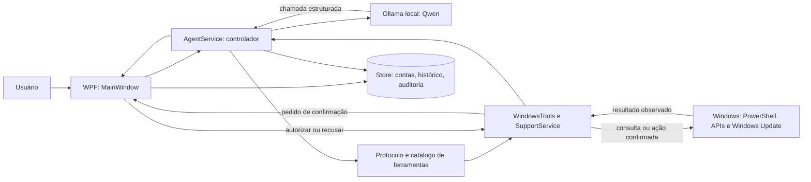

# Arquitetura e limites do Nexo

Estado do código em 16/10/2026. Este documento descreve o aplicativo implementado, não uma capacidade futura prometida.

## Objetivo e requisitos operacionais

O Nexo atende um usuário local do Windows pelo aplicativo WPF. Para cada incidente, deve coletar evidência, selecionar uma ferramenta do catálogo, pedir autorização antes de alterar o sistema, observar o resultado e distinguir correção confirmada de hipótese ou falha. Quando a função depender do usuário (som, imagem, impressão ou aplicativo), deve solicitar um teste funcional. Se não houver ferramenta ou evidência suficiente, deve parar e oferecer um relatório local para encaminhamento à TI.

O aplicativo é iniciado pelo usuário e conduz o atendimento no chat. Ele não é um serviço permanente que monitora ou repara o computador em segundo plano.

## Componentes e fluxo

| Parte | Responsabilidade principal |
|---|---|
| `Nexo.Support/MainWindow.xaml.cs` | Chat, confirmação concreta do usuário, progresso, cancelamento e relatório de encaminhamento. |
| `Nexo.Support/Core.cs` | Contas, permissões, senhas com PBKDF2, conversas e persistência em `%LOCALAPPDATA%\NexoSupport\data.json`. |
| `Nexo.Support/AgentService.cs` e `AgentProtocol.cs` | Prompt, chamadas ao Ollama, catálogo permitido, limites de etapas, continuidade e validação de conclusões. |
| `Nexo.Support/WindowsTools.cs` e `SupportService.cs` | Fronteira de execução: consultas e ações específicas do Windows, validação, autorização e resultados. |
| `Nexo.Support/NetworkWorkflow.cs`, `NetworkAssessment.cs` e scripts de rede | Diagnóstico guiado de falta de conexão, identidade da interface, espera de recuperação, transação IP/DNS e restauração. |
| `Nexo.Checks` | Regressões determinísticas, simulações de executor e avaliações com Qwen local. |

O painel **Registro de ações** mostra métricas calculadas dos atendimentos locais encerrados: resoluções marcadas pelo usuário, encaminhamentos preparados e tempo médio entre abertura e encerramento. A auditoria de ferramentas registra duração em milissegundos e apenas parâmetros categóricos validados. Conversas ainda em andamento ficam fora das taxas. Essas medidas não representam uma taxa de reparo comprovada em hardware. A gravação local substitui `data.json` após escrever um arquivo temporário; mudanças de conta, perfil, auditoria e encerramento revertem a memória se a gravação falhar.

## Fronteiras de confiança

1. O texto do usuário, a resposta do modelo, o histórico e as saídas das consultas são dados não confiáveis. Uma instrução contida nesses dados não concede uma ferramenta nova.
2. O modelo recebe esquemas de ferramentas predefinidas. O executor escolhe por nome em um `switch`; não expõe shell genérico ao modelo. Argumentos e identidade do alvo precisam ser validados pelo executor, mesmo quando o esquema do modelo os descreve.
3. A conta precisa ter permissão de diagnóstico; correções exigem permissão de reparo e confirmação específica no aplicativo. Ações elevadas solicitam UAC do Windows. Recusa encerra a etapa sem executar a alteração.
4. Rede usa GUID/índice observados e reconferidos. Mudanças IP/DNS registram estado anterior, têm confirmação de manutenção e caminho de restauração. Um comando aceito ainda exige observação posterior para comprovar funcionamento.
5. Drivers são limitados a itens encontrados pelo Windows Update e escolhidos por ID. A instalação pode exigir reinicialização; o Nexo não reinicia o PC automaticamente.

## Fluxos principais

**Conversa ou dúvida:** o controlador pode responder sem consultar o Windows, desde que não alegue uma operação não registrada.

**Componente:** uma triagem inicial consulta câmera, áudio, Bluetooth ou impressão. O agente recebe os alvos observados e pode consultar serviços/filas, propor uma correção permitida e obter o resultado. Estado PnP ou serviço ativo não comprova a função; o atendimento pede teste no aplicativo do usuário.

**Falta de conexão:** o fluxo guiado inventaria interfaces, testa conexão, observa link e compara sondagens por interface. Uma única mudança autorizada deve ser seguida por leitura e testes repetidos para confirmar estabilidade. Resultados parciais, recusa, falha ou alvo ambíguo impedem declarar resolução.

**Encaminhamento:** quando a correção não está implementada ou o teste não confirma a função, o usuário pode preparar e exportar um relatório local. O Nexo não envia automaticamente um chamado para um sistema externo.

## Limitações verificáveis

- As suítes simulam ações e resultados; não provam que driver, cabo, câmera, áudio, Bluetooth ou impressora físicos foram reparados.
- A sondagem de rede testa IPv4 e destinos TCP específicos. Não comprova todos os sites, IPv6, proxy, VPN ou redes internas.
- O catálogo não implementa pareamento Bluetooth, reparo físico, todas as permissões corporativas, configuração de impressoras de rede nem execução arbitrária de comandos.
- O modelo e o Ollama são instalados separadamente do executável. Sem eles, os atendimentos guiados pela IA não funcionam.
- O armazenamento local contém histórico e resultados técnicos em JSON; trate backups e exportações como dados potencialmente sensíveis.
- Operações elevadas já iniciadas são aguardadas para que o Nexo não apresente cancelamento como reversão concluída. Ainda falta um mecanismo de supervisão para processos elevados travados; esse limite impede considerar timeout e cancelamento totalmente validados.

## Evolução controlada

As próximas extensões devem adicionar primeiro observação, ação limitada, autorização, verificação e caso de regressão. Métricas por cenário devem incluir seleção correta, alteração indevida, fidelidade da resposta, tempo e intervenção humana. Testes elevados e de falha física pertencem a uma VM ou máquina de laboratório com plano de restauração.
