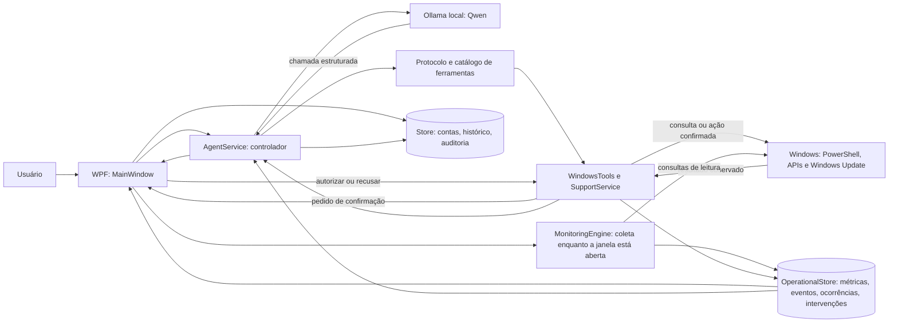

# Arquitetura e limites do Nexo

Estado do código em 07/11/2026, na branch `development`. Este documento descreve o aplicativo implementado, não uma capacidade futura prometida.

## Objetivo e requisitos operacionais

O Nexo abre direto para o usuário atual do Windows, sem tela de login do aplicativo. A sessão local pode diagnosticar e solicitar correções, mas não tem administração de contas. Para cada incidente, deve coletar evidência, selecionar uma ferramenta do catálogo, pedir autorização antes de alterar o sistema, observar o resultado e distinguir correção confirmada de hipótese ou falha. Quando a função depender do usuário (som, imagem, impressão ou aplicativo), deve solicitar um teste funcional. Se não houver ferramenta ou evidência suficiente, deve parar e oferecer um relatório local para encaminhamento à TI.

O aplicativo é iniciado pelo usuário e conduz o atendimento no chat. Enquanto a janela está aberta, ele também coleta métricas locais e calcula alertas por regras. Ele não é um serviço do Windows: fechado o aplicativo, a coleta para, e nenhuma correção é feita em segundo plano sem o pedido e a autorização do usuário.

## Componentes e fluxo

| Parte | Responsabilidade principal |
|---|---|
| `Nexo.Support/MainWindow.xaml.cs` | Chat, confirmação concreta do usuário, progresso, cancelamento e relatório de encaminhamento. |
| `Nexo.Support/Core.cs` | Sessão direta vinculada ao perfil Windows, permissões, conversas e persistência em `%LOCALAPPDATA%\NexoSupport\data.json`. |
| `Nexo.Support/AgentService.cs` e `AgentProtocol.cs` | Prompt, chamadas ao Ollama, catálogo permitido, limites de etapas, continuidade e validação de conclusões. |
| `Nexo.Support/WindowsTools.cs` e `SupportService.cs` | Fronteira de execução: consultas e ações específicas do Windows, validação, autorização e resultados. |
| `Nexo.Support/NetworkWorkflow.cs`, `NetworkAssessment.cs` e scripts de rede | Diagnóstico guiado de falta de conexão, identidade da interface, espera de recuperação, transação IP/DNS e restauração. |
| `Nexo.Support/DriverWorkflow.cs`, `OfficialDriverSource.cs` e `DriverStoreInventory.cs` | Fluxo limitado de drivers, catálogo e download oficiais da NVIDIA, e consulta do INF instalado. |
| `Nexo.Support/RestorePointProtection.cs` e `OperationSupervisor.cs` | Exigem um ponto de restauração confirmado antes de instalar um driver e aguardam a operação elevada até um prazo; sem resultado no prazo, o estado fica desconhecido. |
| `Nexo.Support/MonitoringEngine.cs`, `WindowsHealthSampler.cs`, `ConnectivityProbe.cs` e `WindowsEventCollector.cs` | Coleta local de métricas, sondagens opcionais de rede e eventos do Windows. |
| `Nexo.Support/HealthRules.cs`, `DiagnosticEngine.cs`, `EventAnalyzer.cs` e `HealthReportPresentation.cs` | Regras dos alertas, análise de eventos e relatório de saúde, disponível ao agente por `get_health_report`. |
| `Nexo.Support/OperationalStore.cs` | Banco SQLite `operations.db`, separado das conversas: métricas, eventos, ocorrências e intervenções, com retenção configurável. |
| `Nexo.Setup` | Instalador `NexoSetup.exe`: valida o manifesto assinado e os pacotes baixados, e instala o aplicativo, o Ollama e o modelo no perfil atual. |
| `Nexo.Checks` e `Nexo.Setup.Checks` | Regressões determinísticas, simulações de executor e avaliações com Qwen local; regressões do instalador. |

O painel **Registro de ações** mostra métricas calculadas dos atendimentos locais encerrados: resoluções marcadas pelo usuário, encaminhamentos preparados e tempo médio entre abertura e encerramento. A auditoria de ferramentas registra duração em milissegundos e apenas parâmetros categóricos validados. Conversas ainda em andamento ficam fora das taxas. Essas medidas não representam uma taxa de reparo comprovada em hardware. A gravação local substitui `data.json` após escrever um arquivo temporário; mudanças de conta, perfil, auditoria e encerramento revertem a memória se a gravação falhar.

## Fronteiras de confiança

1. O texto do usuário, a resposta do modelo, o histórico e as saídas das consultas são dados não confiáveis. Uma instrução contida nesses dados não concede uma ferramenta nova.
2. O modelo recebe esquemas de ferramentas predefinidas. O executor escolhe por nome em um `switch`; não expõe shell genérico ao modelo. Argumentos e identidade do alvo precisam ser validados pelo executor, mesmo quando o esquema do modelo os descreve.
   A consulta de processos limita o nome enviado ao modelo a 40 caracteres e a letras, dígitos, ponto, hífen e sublinhado; o conteúdo continua sendo dado não confiável.
3. A sessão local permite diagnóstico e correções sujeitas a confirmação específica no aplicativo. Ações elevadas solicitam UAC do Windows. Recusa encerra a etapa sem executar a alteração. A administração de contas não é exposta no modo direto.
4. Rede usa GUID/índice observados e reconferidos. Mudanças IP/DNS registram estado anterior, têm confirmação de manutenção e caminho de restauração. Um comando aceito ainda exige observação posterior para comprovar funcionamento.
5. O inventário de hardware usa dispositivos PnP presentes, código de problema, IDs e versão/provedor do driver. A busca online usa a fonte de atualizações configurada no Windows, respeitando Windows Update ou servidor gerenciado. Só são oferecidos drivers cujo HardwareID corresponde exatamente a um único dispositivo observado. Instalação exige confirmação específica, UAC, reconferência da identidade e verificação de versão/estado. Resultado incerto ou reinicialização pendente não comprova correção funcional; o Nexo não reinicia o PC automaticamente nem baixa executáveis de sites arbitrários.

## Fluxos principais

**Conversa ou dúvida:** o controlador pode responder sem consultar o Windows, desde que não alegue uma operação não registrada.

**Componente:** uma triagem inicial consulta câmera, áudio, Bluetooth ou impressão. O agente recebe os alvos observados e pode consultar serviços/filas, propor uma correção permitida e obter o resultado. Estado PnP ou serviço ativo não comprova a função; o atendimento pede teste no aplicativo do usuário.

**Driver solicitado:** um pedido explícito de consulta ou atualização para um componente reconhecido usa um fluxo limitado antes do modelo: inventário do componente, conferência de um alvo único, busca online de ofertas com ID de hardware exato e, somente quando há uma oferta única e o pedido autoriza mudança, confirmação de instalação pelo executor. Quando não há oferta na fonte Windows para uma única GPU NVIDIA, o executor consulta o catálogo oficial NVIDIA para o produto e Windows observados. Uma versão WHQL mais recente pode ser baixada do domínio oficial e instalada após aceite da licença, confirmação no Nexo, assinatura válida e UAC. A versão é lida novamente depois da operação. Ausência de oferta, erro ou versão não confirmada impedem declarar conclusão. Versão alterada ainda exige teste funcional; reinicialização pendente não equivale a resolução.

**Falta de conexão:** o fluxo guiado inventaria interfaces, testa conexão, observa link e compara sondagens por interface. Uma única mudança autorizada deve ser seguida por leitura e testes repetidos para confirmar estabilidade. Resultados parciais, recusa, falha ou alvo ambíguo impedem declarar resolução.

**Monitoramento local:** um coletor serial grava leituras enquanto a janela está aberta. As regras só alertam com leituras suficientes e contínuas, e cada ocorrência é uma hipótese a confirmar, não um reparo. A tendência de memória usa PID e horário de início para identificar um processo, limiares configuráveis e leituras seguidas; observa apenas os 12 maiores consumidores e ainda precisa de calibração em laboratório. A contagem de repetição recomeça ao reabrir o aplicativo ou salvar as preferências. As sondagens de gateway, DNS e destino externo começam desligadas e, quando ativadas, enviam consultas aos destinos configurados. O relatório prioriza ocorrências críticas das últimas 24 horas e informa quando omite as demais. O agente lê esses dados por uma ferramenta somente leitura, e toda alteração segue o fluxo normal de confirmação.

O painel e o relatório distinguem ocorrência persistente, resolvida nas leituras e estado atual desconhecido, com o horário da última coleta. Uma sondagem externa só muda o estado de sua própria configuração; uma resposta de outro destino ou teste não confirma recuperação. "Resolvida" descreve os sensores e ainda exige o teste funcional da pessoa atendida.

**Encaminhamento:** quando a correção não está implementada ou o teste não confirma a função, o usuário pode preparar e exportar um relatório local. O Nexo não envia automaticamente um chamado para um sistema externo.

## Limitações verificáveis

- As suítes simulam ações e resultados; não provam que driver, cabo, câmera, áudio, Bluetooth ou impressora físicos foram reparados.
- O teste real de hardware e da busca online foi somente de leitura; a instalação de drivers precisa de laboratório com restauração.
- A sondagem de rede testa IPv4 e destinos TCP específicos. Não comprova todos os sites, IPv6, proxy, VPN ou redes internas.
- O catálogo não implementa pareamento Bluetooth, reparo físico, todas as permissões corporativas, configuração de impressoras de rede nem execução arbitrária de comandos.
- O modelo e o Ollama são instalados separadamente do executável. Sem eles, os atendimentos guiados pela IA não funcionam.
- O armazenamento local contém histórico e resultados técnicos em JSON e em `operations.db`; trate backups e exportações como dados potencialmente sensíveis.
- Sem resultado no prazo, uma operação elevada fica em estado desconhecido, nunca como concluída. O processo não é encerrado nem revertido por isso, e continua podendo terminar depois.
- Ainda estão abertos: prazo e saída segura para transações de rede travadas (#9), recuperação após encerramento abrupto do executor (#10), autenticação da decisão de manter uma mudança de rede (#11), prazo da instalação NVIDIA (#12) e conferência de que a versão instalada é a oferecida (#13).
- O monitoramento só vê o período com a janela aberta. Temperatura e SMART ficam indisponíveis quando o Windows não fornece leitura confiável, e os sete cenários de falha ainda dependem da VM de laboratório (#8).

## Evolução controlada

As próximas extensões devem adicionar primeiro observação, ação limitada, autorização, verificação e caso de regressão. Métricas por cenário devem incluir seleção correta, alteração indevida, fidelidade da resposta, tempo e intervenção humana. Testes elevados e de falha física pertencem a uma VM ou máquina de laboratório com plano de restauração.
